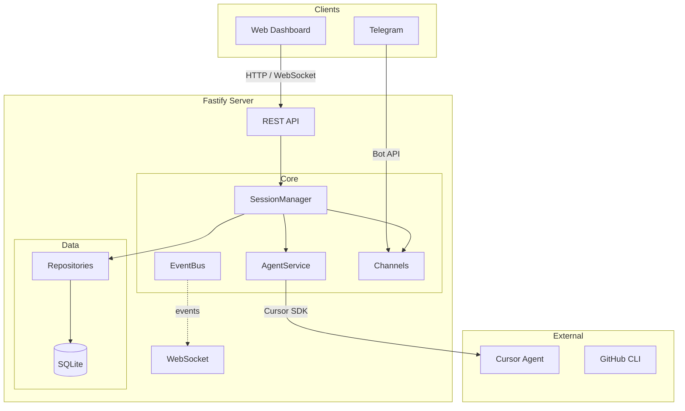

# Cursor Control Plane + CLI (`cursor-cp-cli`)

Fork of [sanjaysingh/cursor-cp](https://github.com/sanjaysingh/cursor-cp) that keeps the original web dashboard, REST API, and Telegram SDK sessions — and adds a **Cursor CLI bridge**: attach Telegram to existing local `agent` chats (`~/.cursor/chats`) via `agent -p --resume`.

[](https://github.com/xabaras/cursor-cp-cli/actions/workflows/ci.yml)
[](LICENSE)
[](https://nodejs.org)

> **Upstream:** this project is based on Cursor Control Plane by Sanjay Singh ([MIT](LICENSE)). Differences from upstream are focused on the Telegram ↔ Cursor CLI integration documented below.

## Table of Contents

- [Overview](#overview)
- [Cursor CLI bridge](#cursor-cli-bridge)
- [Quick Start](#quick-start)
- [Installation](#installation)
- [Background service](#background-service)
- [Configuration](#configuration)
- [Architecture](#architecture)
- [Development](#development)
- [API Reference](#api-reference)
- [Telegram Bot](#telegram-bot)
- [Troubleshooting](#troubleshooting)
- [Contributing](#contributing)
- [License](#license)

## Overview

Cursor Control Plane + CLI runs Cursor agent sessions for you and exposes them through a
real-time web dashboard, a REST API, and an optional Telegram bot. Sessions and
their message history are persisted to SQLite, so they survive restarts and can be
resumed automatically.

This fork additionally lets Telegram continue **existing Cursor CLI chats** on your
machine (created with the `agent` TUI), without going through the SDK session path.

### Features

- **Web dashboard** — real-time chat UI with WebSocket streaming
- **Telegram bot** — drive agents from chat, with inline buttons for sessions, models, and repos
- **Cursor CLI bridge** — attach Telegram to local CLI chats (`/cli`), with modes, queue, and live streaming
- **Persistent sessions** — SQLite-backed session, message, and participant storage
- **Multi-repository support** — work across local workspaces and clone GitHub repos via the `gh` CLI
- **Model selection** — choose any model the Cursor SDK exposes, per session or as a default
- **REST API** — full programmatic access to every feature

## Cursor CLI bridge

Requires the [Cursor CLI](https://cursor.com/docs/cli) (`agent`) installed and authenticated on the same machine as the daemon.

Enable in `~/cursor-cp/config.yaml`:

```yaml
cli_bridge:
  enabled: true
  agent_bin: agent          # or absolute path, e.g. ~/.local/bin/agent
  chats_root: ~/.cursor/chats
  force: true               # --force / no interactive tool approvals
  trust: true
  filter_by_workspace_root: true
  timeout_ms: 600000
  stream_edit_interval_ms: 1200
  notify_on_complete: true  # default; false = edit-only (no Telegram OS notification)
```

Then restart the daemon (`cursor-cp daemon restart`).

### How it works

1. `/cli` lists chats under `~/.cursor/chats` (optionally filtered by `workspace_root`).
2. Attaching a chat routes subsequent plain-text Telegram messages to  
   `agent -p --resume <chatId> --workspace <cwd> --trust --force`.
3. While the agent runs, Telegram shows a **streaming preview** updated with `editMessageText`.
4. When the run finishes (default `notify_on_complete: true`), that preview is deleted and the
   full reply is sent as a **new** message so Telegram can fire an OS notification.
   Set `notify_on_complete: false` to keep the edit-only behaviour (no notification).
5. Without a CLI attach, plain text still uses **SDK sessions** (`/sessions`, `/workspaces`, …).
6. Avoid using the **same** CLI chat in the terminal TUI and Telegram at the same time.

### Telegram CLI commands

| Command | Description |
|---------|-------------|
| `/cli` | List and attach a CLI chat (filtered by `workspace_root` when enabled) |
| `/cli all` | List all CLI chats |
| `/cli new` | Create and attach a new CLI chat |
| `/cli mode [agent\|plan\|ask]` | Show or set CLI execution mode (persisted with the attach) |
| `/cli plan` / `/cli ask` / `/cli agent` | Shortcuts for `/cli mode` |
| `/cli cancel` | Stop the current CLI run |
| `/cli cancel all` | Stop the run and clear the queue |
| `/cli off` | Detach CLI mode (back to SDK sessions) |
| `/cli status` | Show attach status, mode, and queue |

**Modes:** `agent` (default, can edit; uses `--force`), `plan` and `ask` (read-only via `agent --mode`). Cursor IDE **debug** mode is not available in headless CLI.

Jobs for the same Telegram chat are queued FIFO. Replies stream via Telegram message edits,
then (by default) arrive as a final `sendMessage` so you get a notification when Cursor is done.

## Quick Start

### Prerequisites

| Requirement | Minimum | Recommended | Notes |
|-------------|---------|-------------|-------|
| Node.js | 20.x | 22.x | Prefer 22.x if native modules fail on newer Node |
| npm | 9.x | latest | Ships with Node.js |
| Cursor API key | — | — | [Get one here](https://cursor.com/dashboard/cloud-agents) |
| Cursor CLI (`agent`) | — | latest | Required for the CLI bridge |
| Git | any | latest | Required to clone/update |
| GitHub CLI (`gh`) | — | latest | Optional, enables repo browsing/cloning |

### Install (macOS / Linux)

```bash
curl -fsSL https://raw.githubusercontent.com/xabaras/cursor-cp-cli/main/install.sh | bash
```

That's the supported install method. It performs a per-user install (no `sudo`,
everything inside your home directory): it clones the project to
`~/.local/share/cursor-cp`, installs dependencies, builds it, and adds a `cursor-cp`
launcher to `~/.local/bin`.

Configure it after install:

```bash
cursor-cp setup    # API key, default model, port, optional Telegram, daemon
```

Then start the server (or enable the daemon during setup):

```bash
cursor-cp        # serve at http://localhost:8747
```

Enable `cli_bridge` in `~/cursor-cp/config.yaml` if you want Telegram ↔ CLI chats.

Re-run the wizard anytime with `cursor-cp setup`, and verify your install with
`cursor-cp doctor`.

> **Prefer to clone and run from source?** See [Development](#development).

## Installation

### One-line installer

```bash
curl -fsSL https://raw.githubusercontent.com/xabaras/cursor-cp-cli/main/install.sh | bash
```

On an interactive terminal the installer prints next steps; run `cursor-cp setup`
to configure your API key, model, port, and optional Telegram bot.

Pass options through the pipe with `bash -s --`:

```bash
# Install a specific tag/branch, or to a custom directory
curl -fsSL https://raw.githubusercontent.com/xabaras/cursor-cp-cli/main/install.sh \
  | bash -s -- --version main --dir "$HOME/apps/cursor-cp"
```

You can also download and run it directly (`bash install.sh [options]`).

| Flag | Environment variable | Default | Description |
|------|----------------------|---------|-------------|
| `--version <ref>` | `CURSOR_CP_VERSION` | `latest` (main) | Git tag/branch to install |
| `--dir <path>` | `CURSOR_CP_INSTALL_DIR` | `~/.local/share/cursor-cp` | Install location |
| `--help` | — | — | Show usage |

**Upgrading:** re-run the same one-liner. The installer detects the existing install,
fetches and checks out the requested version, reinstalls dependencies, and rebuilds.
Your configuration in `~/cursor-cp/` is never touched.

### Configuring and running

```bash
cursor-cp setup     # interactive wizard: API key, model, port, Telegram, daemon
cursor-cp           # start the server in the foreground
cursor-cp doctor    # check your installation for problems
cursor-cp help      # list all commands and options
```

Foreground mode is fine for trying things out. For day-to-day use, run cursor-cp in the
background and enable auto-start on login — see [Background service](#background-service).

If `~/.local/bin` is not on your `PATH`, the installer prints the line to add to your
shell profile.

### Background service

Run cursor-cp as a per-user background service so it keeps running after you close the
terminal and starts automatically when you log in. Supported on **macOS** and **Linux**
(installed via the one-line installer or `~/.local/bin/cursor-cp`).

#### Enable auto-start (recommended)

**Option A — during setup** (easiest). The install wizard asks:

> Run cursor-cp in the background on login (enable daemon)?

Answer **yes**. The daemon is installed, started, and configured to start on every login.

**Option B — after install:**

```bash
cursor-cp daemon enable
```

This registers a user service, starts it immediately, and enables auto-start:

| Platform | Mechanism | Unit file |
|----------|-----------|-----------|
| Linux | systemd user service | `~/.config/systemd/user/cursor-cp.service` |
| macOS | LaunchAgent | `~/Library/LaunchAgents/com.cursor.cp.plist` |

Verify it is running:

```bash
cursor-cp daemon status
cursor-cp doctor          # includes a daemon check
```

Open the dashboard at `http://localhost:8747` (or whatever `server.port` is in your config).

#### Manage the daemon

```bash
cursor-cp daemon status    # show type, running/stopped, install date
cursor-cp daemon start     # start (if enabled but stopped)
cursor-cp daemon stop      # stop without removing auto-start
cursor-cp daemon restart     # restart after config changes
cursor-cp daemon disable   # stop, remove unit, disable auto-start
```

After editing `~/cursor-cp/config.yaml`, apply changes with:

```bash
cursor-cp daemon restart
```

#### Logs

| Platform | Where to look |
|----------|---------------|
| Linux | `journalctl --user -u cursor-cp.service -f` |
| macOS | `~/cursor-cp/logs/service.log` and `service.error.log` |
| Both | Daily app logs under `~/cursor-cp/logs/cursor-cp-YYYY-MM-DD.log` |

#### Non-interactive setup

Skip the prompt and enable the daemon in one step:

```bash
cursor-cp setup --enable-daemon
```

To run setup without enabling the daemon:

```bash
cursor-cp setup --no-daemon
```

#### Windows

Background service installation is not supported on Windows. Run in the foreground with
`cursor-cp` or `npm run dev` when developing from source.

### Runtime layout

All runtime data lives under `~/cursor-cp/`:

```
~/cursor-cp/
├── config.yaml   your settings (created from config.default.yaml on install)
├── ws-root/      cloned repositories / agent working directories
├── logs/         daily JSON logs (cursor-cp-YYYY-MM-DD.log, kept 7 days)
└── data/         SQLite database (cursor-cp.db) and daemon metadata
```

Shipped defaults live in the install directory as `config.default.yaml` (never edit this file directly).

## Configuration

Settings use two YAML files:

| File | Location | Committed? | Purpose |
|------|----------|------------|---------|
| `config.default.yaml` | install / source tree | yes | shipped defaults |
| `config.yaml` | `~/cursor-cp/` (or project root when developing) | no | your overrides |

`config.yaml` is merged on top of `config.default.yaml`. Only values you set in `config.yaml` replace the defaults — everything else falls through.

On install, `~/cursor-cp/config.yaml` is created automatically as a copy of `config.default.yaml`. Run `cursor-cp setup` to fill in your API key and other settings interactively, or edit the file by hand. Secrets (`cursor.api_key`, Telegram token) are stored in `config.yaml` with `chmod 600`.

When developing from source, copy defaults into the project root:

```bash
cp config.default.yaml config.yaml   # then set cursor.api_key
```

Project-root `config.yaml` is gitignored and overrides `~/cursor-cp/config.yaml` when present.

**After editing, restart to apply:**

```bash
cursor-cp daemon restart   # background
cursor-cp                    # foreground
```

### Example overrides (`config.yaml`)

See [`config.default.yaml`](config.default.yaml) for the full template. Typical overrides:

```yaml
cursor:
  api_key: "cursor_..."       # required

server:
  host: 0.0.0.0
  port: 8747

sdk:
  default_model: "composer-2.5"
  max_sessions: 5

channels:
  telegram:
    enabled: false
    bot_token: ""
    allowed_user_ids: []
  web:
    enabled: true

logging:
  level: info
  # file: false               # omit = daily logs under ~/cursor-cp/logs

repos: []
# workspace_root: ~/cursor-cp/ws-root
```

Console logging is always enabled; daily file logging is on by default.

## Architecture



### Data flow

1. **Session creation** — Client → API → `SessionManager` → `AgentService` (creates an SDK agent).
2. **Messages** — User → `SessionManager` → `AgentService` → Cursor SDK → streamed response.
3. **Real-time updates** — `AgentService` → `EventBus` → WebSocket → web clients; non-web channels receive the full reply when the run completes.

### Module structure

```
src/
├── api/        # Fastify routes + WebSocket registration
├── channels/   # Communication adapters (web, Telegram) + registry
├── config/     # YAML configuration loading
├── core/       # Business logic: AgentService, SessionManager, EventBus, repo picker
├── db/         # SQLite connection and repositories
├── format/     # Markdown → Telegram formatting
├── models/     # TypeScript types and Zod schemas
├── service/    # systemd/launchd daemon control
├── util/       # Logger and daily log rotation
├── cli/        # CLI: serve, setup wizard, doctor, config, daemon
├── paths.ts    # Runtime path resolution
└── index.ts    # Application entry point
static/         # Web dashboard (Alpine.js + Tailwind via CDN)
```

## Development

```bash
git clone https://github.com/xabaras/cursor-cp-cli.git
cd cursor-cp-cli
npm install
cp config.default.yaml config.yaml   # then set cursor.api_key
npm run dev
```

### Commands

| Command | Description |
|---------|-------------|
| `npm run dev` | Start the server with hot reload (`tsx watch`) |
| `npm run build` | Compile TypeScript to `dist/` |
| `npm start` | Run the compiled server (`node dist/index.js`) |
| `npm test` | Run the test suite (Vitest) |
| `npm run test:watch` | Run tests in watch mode |
| `npm run lint` | Lint with ESLint |
| `npx tsc --noEmit` | Type-check without emitting |

The database schema is created and migrated automatically on first connection — there
is no separate migration step.

## API Reference

All endpoints are served under the `/api` prefix.

### Health & config

```http
GET /api/health
# → { "status": "ok", "version": "0.5.3" }

GET /api/dashboard-config
# → { "web_channel_key": "web:default", "workspace_root": "...", "default_model": "...", "max_sessions": 5 }
```

### Sessions

```http
GET  /api/sessions?include_closed=false      # List sessions
POST /api/sessions                           # Create a session
GET  /api/sessions/:id                        # Get a session
GET  /api/sessions/:id/messages               # Get message history
POST /api/sessions/:id/message                # Send a message
POST /api/sessions/:id/join                   # Join an existing session
POST /api/sessions/:id/answer                 # Answer a pending agent question
POST /api/sessions/:id/close                  # Close and delete a session
POST /api/sessions/close-all                  # Close and delete all sessions
```

Create a session:

```http
POST /api/sessions
Content-Type: application/json

{
  "repoPath": "/path/to/repo",   // optional; defaults to the workspace root
  "title": "My Session",          // optional
  "model": "composer-2.5"         // optional; null/omitted uses the default
}
```

### Repositories & models

```http
GET  /api/workspaces                  # Local workspace folders
GET  /api/github/repos?limit=40       # GitHub repos (requires gh CLI)
POST /api/github/clone                # Clone a repo into the workspace
GET  /api/repo-picker?gh_limit=80     # Combined, de-duplicated local + GitHub list
GET  /api/models                      # Available models
PUT  /api/settings/default-model      # Set the default model
```

### WebSocket

Connect to `/api/ws` for real-time updates. Send `{ "type": "ping" }` to receive a
`{ "type": "pong" }` keep-alive. Server events include `hello`, `session_updated`,
`session_removed`, `sessions_purged`, `agent_stream`, `channel_message`, and `question`.

## Telegram Bot

Set `channels.telegram.enabled: true`, add `bot_token` and your user ID(s) in
`allowed_user_ids` in `config.yaml`. The bot exposes the following commands:

| Command | Description |
|---------|-------------|
| `/start` | Show help |
| `/sessions` | List sessions and connect |
| `/models` | List models and set the default |
| `/current` | Show the current session or CLI attach |
| `/close` | Close the current session |
| `/closeall` | Close all sessions |
| `/repos` | Browse and clone GitHub repos (`gh`) |
| `/workspaces` | Browse local workspace folders |
| `/cli` … | Cursor CLI bridge (see [Cursor CLI bridge](#cursor-cli-bridge)) |
| `/version` | Show Control Plane version |

Any other text is sent to the attached CLI chat (if any) or the active SDK session.
Only users listed in `channels.telegram.allowed_user_ids` are allowed to interact with the bot.

## Troubleshooting

**`cursor.api_key is required`** — Run the setup wizard, or set the key in config:

```bash
cursor-cp setup
# or edit ~/cursor-cp/config.yaml (cursor.api_key)
```

**Port already in use** — Change `server.port` in `config.yaml` and restart.

**GitHub features unavailable** — Install and authenticate the GitHub CLI:

```bash
gh auth login
```

**CLI bridge: `agent` not found** — Install the Cursor CLI and set `cli_bridge.agent_bin` to its absolute path.

**CLI bridge: wrong chats listed** — Set `workspace_root` and keep `cli_bridge.filter_by_workspace_root: true`, or use `/cli all`.

**Verbose logging** — Set `logging.level: debug` in `config.yaml` and restart.

## Contributing

Contributions are welcome! Please read the [Contributing Guide](CONTRIBUTING.md) before
opening a pull request. All pull requests must pass lint, type check, tests, and build
in CI.

Bug reports and PRs for this fork: [xabaras/cursor-cp-cli](https://github.com/xabaras/cursor-cp-cli).
Upstream project: [sanjaysingh/cursor-cp](https://github.com/sanjaysingh/cursor-cp).

## License

[MIT](LICENSE) © Sanjay Singh

Additional modifications in this fork © contributors to
[xabaras/cursor-cp-cli](https://github.com/xabaras/cursor-cp-cli).
